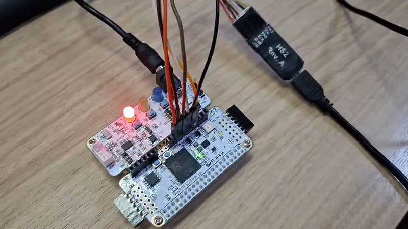
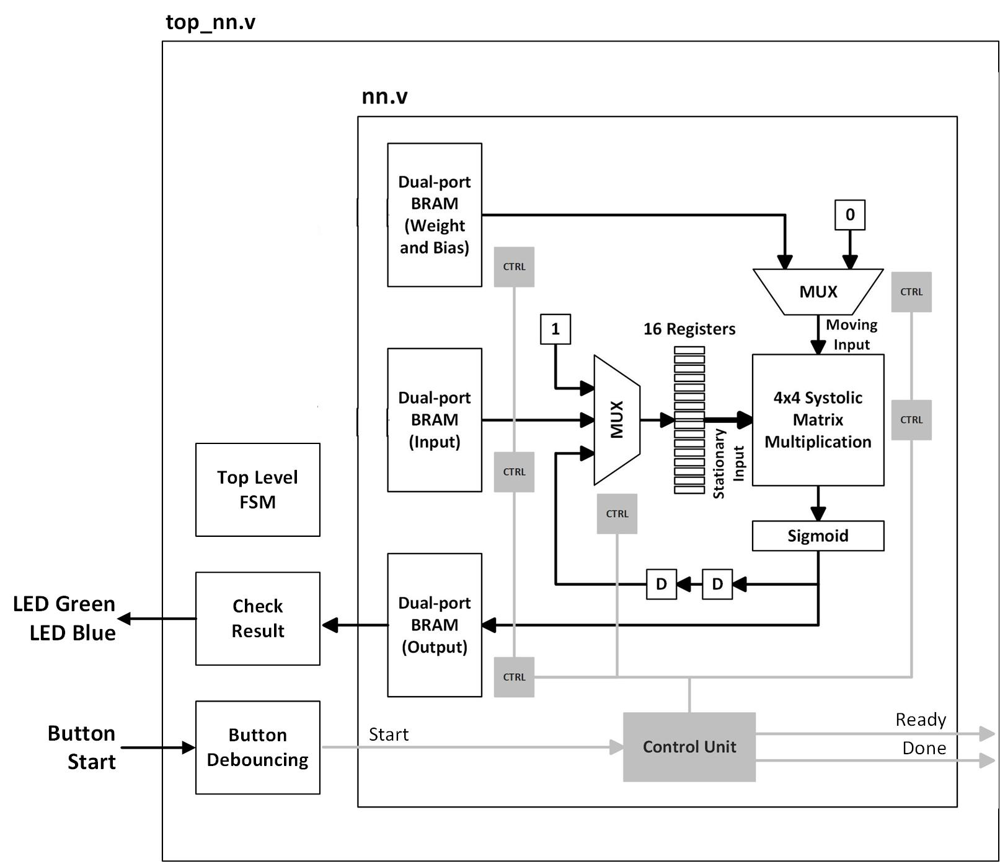

# ZERO7 Tutorial

### Reference

- [LSI Contest](https://www.lsi-contest.com/shiyou_1e.html)
- [Raspberry Pi and ZERO7: From Setup to Design and Operation](https://www.lsi-contest.com/Initialize_20260618_EN.pdf)
- [ZERO7 FPGA Connection Table](https://www.lsi-contest.com/ZERO7FPGA_Connection-table_261109_001.pdf)
- [FPGA Tutorial Slides]
  - [Part 1]()
  - [Part 2]()
  - [Part 3]()
  - [Part 4]()
- PYNQ FPGA Tutorial
  - [PYNQ Tutorial 1: Board Setup and GPIO](https://hackmd.io/@ween168/SyNPIkUb1x)
  - [PYNQ Tutorial 2: DMA and Custom IP](https://hackmd.io/@ween168/r1VchK_Zyg)
  - [PYNQ Tutorial 3: Block Memory and Custom IP](https://hackmd.io/@ween168/rkZnpSxfkl)
  - [PYNQ Tutorial 4: Neural Network Processor](https://hackmd.io/@ween168/SyoWdqWMke)
  
### 1. Blink Example

### 2. Neural Network Example

